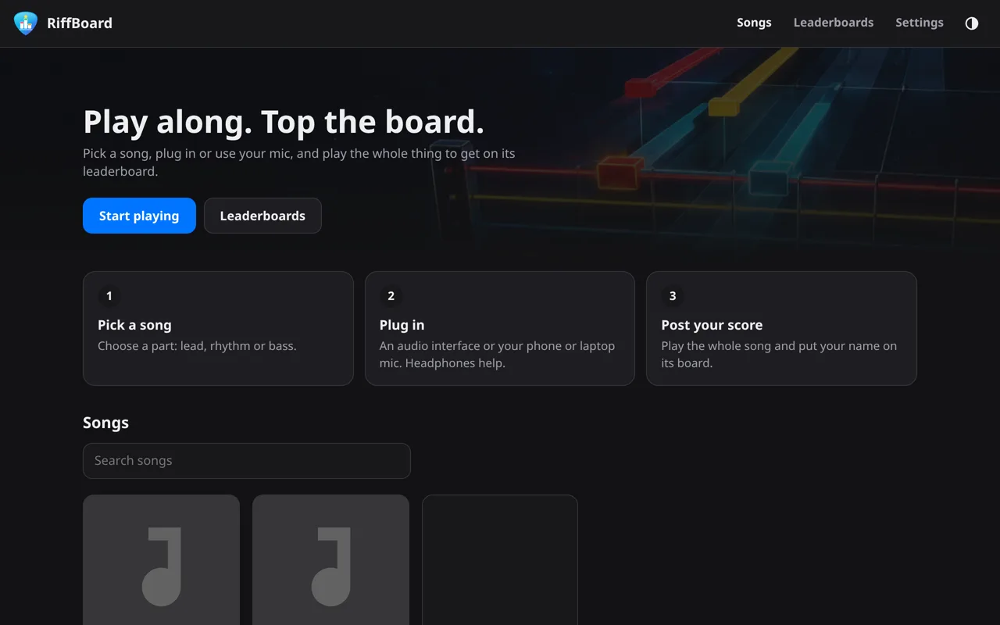
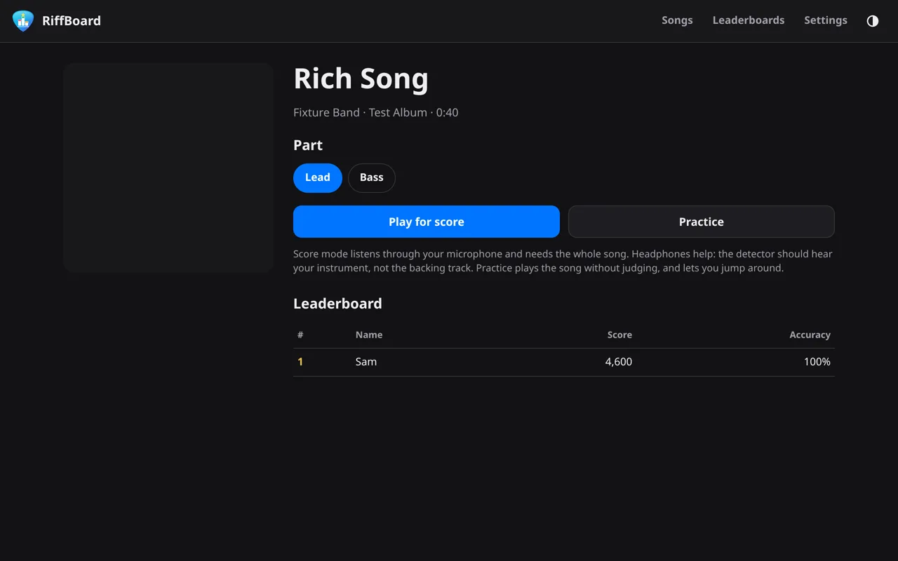

#  RiffBoard

A public, play-only rhythm game for guitar and bass, with a highscore table for every song.



RiffBoard is a website where anyone can pick a song, plug in a guitar or bass (or play near their microphone) and play along to a scrolling note highway. Notes are detected in the browser, and a full run can be posted to that song's public leaderboard.

It's built for hosting your own small catalogue (songs by friends' bands, your own music) on the open internet. You chart the songs, drop the files in a folder, and people come and play them. There are no accounts and nothing for visitors to configure on the server.

RiffBoard started as a fork of [fee[dB]ack](https://github.com/got-feedback/feedBack), a self-hosted practice app designed for one trusted user on a home network. RiffBoard rewrote the server in Rust for a public site, and from 0.4 the player is its own game engine too: Rust compiled to WebAssembly, drawing with WebGL2.

## Features

- **A real game engine in the browser.** The note highway is a Rust game compiled to WebAssembly (about 110 KB gzipped) with its own WebGL2 renderer. Every frame is a handful of batched draw calls with no garbage collection, and the song clock comes from the audio hardware, so notes glide smoothly on phones and 120 Hz screens alike.
- **Note detection that knows the song.** The microphone is judged against the notes that are due: the right pitch, freshly played, around the right time. A wrong fret counts as a miss and a note still ringing from earlier doesn't count twice. Audio never leaves the visitor's device.
- **Score and practice modes.** *Play for score* judges the whole song from start to finish, with no skipping. *Practice* plays without judging; click any section on the navigator along the top to jump there, or restart from the pause menu.
- **Leaderboards.** Every song part has its own board for score runs. Each name keeps its best score.
- **No accounts.** Visitors type a name when they post a score. Settings live in their own browser.
- **Made to be played on anything.** Phones in portrait or landscape, laptops and big screens, left-handed mode, lowest string at the top or bottom, adjustable note speed, mic delay and picture offset.
- **Light and dark themes.** Follows the system setting, with a remembered override. The game screen always stays dark.
- **Hands-off library.** Drop `.feedpak` files into the library folder and they appear within five minutes.

| Songs | Leaderboard | Player |
|---|---|---|
|  |  |  |

## Built for the open internet

Upstream fee[dB]ack exposes about 120 unauthenticated endpoints that change server state: settings, uploads, deletes, plugin updates, metadata scraping. That's fine on a LAN and dangerous anywhere else. RiffBoard's server works the other way round:

- **Allowlist, not blocklist.** Every request passes through [`src/guard.rs`](src/guard.rs). Only listed method and path pairs are served; anything else is a 404 before any route code runs. That includes WebSockets. The whole public surface is a dozen routes.
- **Read-only library.** The only writes a visitor can make are "start a run" and "post a score". The library folder is never written to. The image runs as a non-root user and works with a read-only root filesystem.
- **Score checks.** Scores are computed by the server from hit/miss counts, with the same rules code the game uses ([`crates/core/src/rules.rs`](crates/core/src/rules.rs)). A run needs a ticket issued when the song starts, and is only accepted from the same visitor after the chart's length has passed in real time. Hit counts must fit the chart. Both writes are rate-limited per visitor, names are normalised, and the operator can ban names.
- **Locked-down page.** The game page sends a strict Content-Security-Policy: scripts, styles and media only from the site itself, no inline scripts, no framing. There are no analytics, trackers, CDNs or third-party requests of any kind; the font is self-hosted.
- **Small, memory-safe server.** One static Rust binary on a distroless base: no shell, libc or OpenSSL in the image, a few MB of RAM at idle.

Note detection runs in the browser, so a determined cheater could still forge a score. The checks above make that tedious rather than impossible. For a community board that's normally enough, and the admin tool can clean up anything that slips through.

## Running it

You'll need Docker, plus your songs as `.feedpak` files ([format spec](https://github.com/got-feedback/feedpak-spec)). Subfolders are fine; `Artist/Song.feedpak` is a tidy layout.

```bash
git clone https://github.com/Imdabossou/RiffBoard.git
cd RiffBoard
mkdir library            # put your .feedpak files in here
docker compose up -d --build
```

Then open `http://<host>:8000`. Visitors need HTTPS for microphone access in most browsers, so put it behind a reverse proxy or tunnel with TLS when it goes public.

### Configuration

All server settings come from the environment. None can be changed over HTTP.

| Variable | Default | What it does |
|---|---|---|
| `DLC_DIR` | `/dlc` | The song library folder (read-only is fine). |
| `CONFIG_DIR` | `/config` | Where scores, caches and the admin token live. Back this up. |
| `RIFFBOARD_CLIENT_IP_HEADER` | unset | Behind a proxy, the header holding the visitor's IP (for example `CF-Connecting-IP` or `X-Forwarded-For`), so rate limits apply per visitor. Only set it if your proxy always sets this header. |
| `RIFFBOARD_RESCAN_SECONDS` | `300` | How often the library is rescanned (minimum 30). |
| `APP_SOURCE_URL` | this repo | Where the footer's "Source code" link points. If you change the code, point it at your fork (see Licence). |
| `LOG_LEVEL` / `LOG_FORMAT` | `INFO` / text | Logging (`json` for structured logs). |

If the library's files belong to a specific user, run the container as that user (`user: "1000:1000"` in compose) and make sure it can write to the config volume.

### Branding your site

A RiffBoard install can present itself as your band's (or label's) own play-along site. Put a `site.json` and its images in `$CONFIG_DIR/site/`; see [docs/examples/site.json](docs/examples/site.json). You can set the site name, tagline, home-page hero text and image, a logo and favicon, an "About" card with links, and colours for the dark and light themes.

Every value is validated: colours must be `#rrggbb`, links must be http(s), text is shown as plain text, and images must be PNG, JPEG, WebP or ICO files in that folder. Changes apply on the next page load, with no restart needed. Without a `site.json`, RiffBoard uses its plain monochrome theme, in light and dark, with the visitor's system accent colour where the browser offers one, so it suits any band out of the box.

To make your own colour theme, add `dark` and `light` sections to `site.json`, as in the example. You only need the colours you want to change:

| Keys | What they colour |
|---|---|
| `bg`, `sidebar`, `card`, `cardMuted`, `border` | Backgrounds and outlines |
| `primary`, `primaryHi`, `onPrimary` | Buttons and highlights, their hover state, and the text on them |
| `text`, `textDim` | Text |
| `gold` | The top score |

The site uses each visitor's system font. Set `"font": "rubik"` to use the Rubik font that ships with RiffBoard instead.

The game screen keeps its own colours: the string colours tell players which string to play.

### Admin tool

Moderation and rescans use the same binary's `admin` subcommand inside the container. It talks to admin routes that only answer on loopback with a token from the config volume:

```bash
docker compose exec riffboard /app/riffboard admin rescan
docker compose exec riffboard /app/riffboard admin recent 20
docker compose exec riffboard /app/riffboard admin delete 42
docker compose exec riffboard /app/riffboard admin ban "Some Name"
docker compose exec riffboard /app/riffboard admin wipe "Artist/Song.feedpak"
```

## Charting songs

RiffBoard plays charts; it doesn't make them. Use fee[dB]ack's editor or any tool that writes [feedpak](https://github.com/got-feedback/feedpak-spec) files, then copy the `.feedpak` into the library folder.

## Development

You'll need Rust (stable, edition 2024) with the `wasm32-unknown-unknown` target, the [wasm-bindgen CLI](https://github.com/wasm-bindgen/wasm-bindgen) at the version `crates/game/Cargo.toml` pins, and optionally binaryen's `wasm-opt`.

```bash
bash scripts/build-game.sh                    # builds the game into static/game/pkg/
DLC_DIR=./library CONFIG_DIR=./.config cargo run      # serves http://localhost:8000

cargo test --workspace                        # unit tests + end-to-end replay of tests/golden
cargo clippy -p riffboard-game --target wasm32-unknown-unknown -- -D warnings
```

The project is a Cargo workspace:

| Part | What it is |
|---|---|
| `src/` | The server (axum + tokio, SQLite only for scores). |
| `crates/core` | Game rules shared by the server and the game: chart model, judging, scoring, leaderboard checks, the note detector. Plain Rust, tested natively. |
| `crates/game` | The browser game: WebGL2 renderer, highway layout, camera, HUD. Compiled to wasm. |
| `static/game/` | The page around it: menus in plain HTML, Web Audio playback and the song clock (`player.js`), and the microphone worklet. No build step. |

To check the detector against a recording, run `cargo run -p riffboard-core --example detect_bench --release -- chart.json song.f32` (see the file for details). `tests/golden/golden.json` holds library and chart responses recorded from the original Python server, and `cargo test` checks the Rust server still matches them. [CLAUDE.md](CLAUDE.md) has a fuller map.

## Licence

RiffBoard is free software under the [GNU Affero General Public License v3.0](LICENSE), the same licence as fee[dB]ack. In plain words: you can use, change and share it. If you run a modified version where other people use it over a network, you must offer them its source code too.

The Rubik font is under the SIL Open Font License.

RiffBoard grew out of fee[dB]ack; credit for the song format, the library and chart handling the server is based on, and the original player goes to the [fee[dB]ack contributors](https://github.com/got-feedback/feedBack/graphs/contributors).

## Security

Please report vulnerabilities privately; see [SECURITY.md](SECURITY.md).
