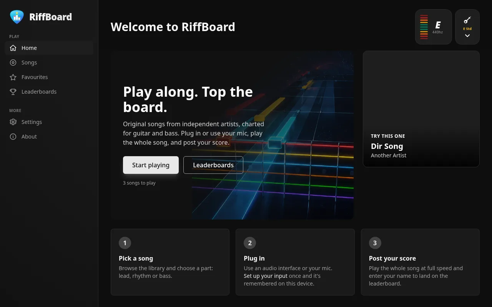
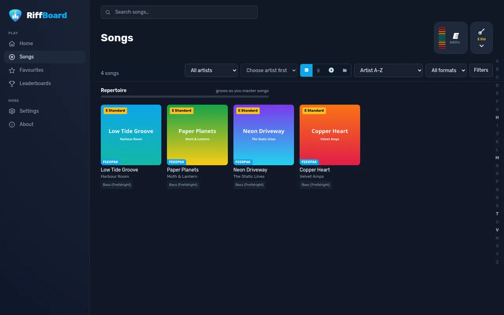
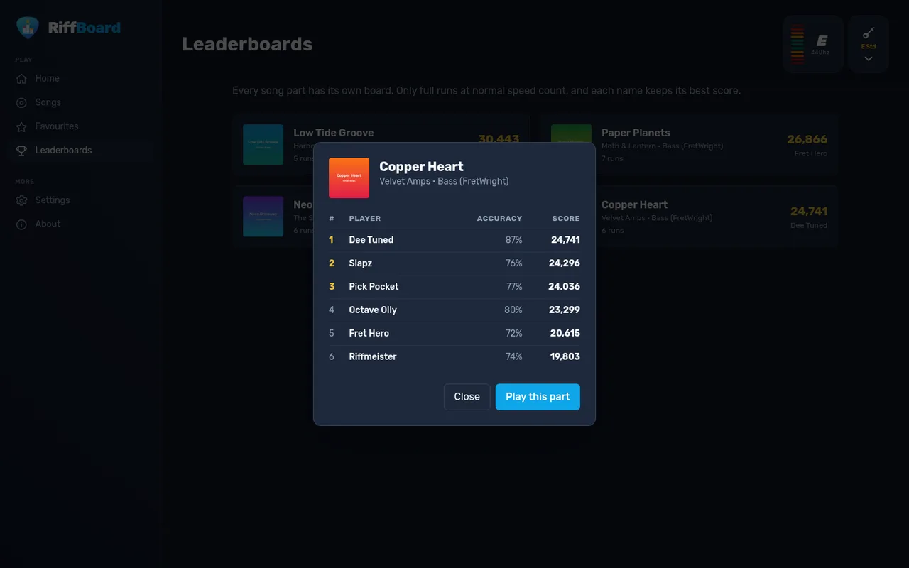
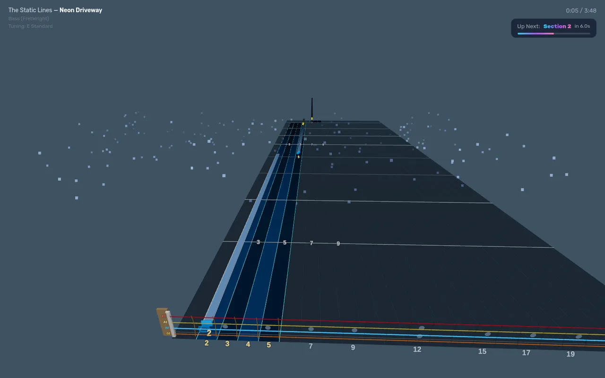

<p align="center"></p>

<h1 align="center">RiffBoard</h1>

<p align="center">A public, play-only rhythm game for guitar and bass, with a highscore table for every song.</p>



RiffBoard is a website where anyone can pick a song, plug in a guitar or bass (or play near their microphone) and play along to a scrolling note highway. Notes are detected in the browser, and a full run can be posted to that song's public leaderboard.

It's built for hosting your own small catalogue (songs by friends' bands, your own music) on the open internet. You chart the songs, drop the files in a folder, and people come and play them. There are no accounts and nothing for visitors to configure on the server.

RiffBoard is a fork of [fee[dB]ack](https://github.com/got-feedback/feedBack), a self-hosted practice app for your own library. fee[dB]ack is designed for one trusted user on a home network. RiffBoard keeps its player and note detection, rewrites the server in Rust, and rebuilds everything around them for a public site.

## Features

- **Play in the browser.** The 3D note highway for guitar and bass (keys and drum highways come along from upstream), with lyrics, sections, count-in, A/V calibration and left-handed mode.
- **Real note detection.** The bundled note-detection plugin listens to your audio input and judges every note. Audio never leaves the visitor's device.
- **Leaderboards.** Every song part has its own board. A run counts when the whole song is played at full speed and difficulty, without skipping, rewinding or looping. Each name keeps its best score.
- **No accounts.** Visitors type a name when they post a score. Settings, favourites and practice history live in their own browser.
- **Light and dark themes.** Follows the system setting, with a remembered override. The player always stays dark.
- **Hands-off library.** Drop `.feedpak` files into the library folder and they appear within five minutes.

| Songs | Leaderboard | Player |
|---|---|---|
|  |  |  |

## Built for the open internet

Upstream fee[dB]ack exposes about 120 unauthenticated endpoints that change server state: settings, uploads, deletes, plugin updates, metadata scraping. That's fine on a LAN and dangerous anywhere else. RiffBoard's server works the other way round:

- **Allowlist, not blocklist.** Every request passes through [`src/guard.rs`](src/guard.rs). Only listed method and path pairs are served; anything else is a 404 before any route code runs. That includes WebSockets.
- **Read-only library.** The only writes a visitor can make are "start a run" and "post a score". The library folder is never written to. The image runs as a non-root user and works with a read-only root filesystem.
- **Score checks.** Scores are computed by the server from hit/miss counts. A run needs a ticket issued when the song starts, and is only accepted from the same visitor after the chart's length has passed in real time. Hit counts must fit the chart. Both writes are rate-limited per visitor, names are normalised, and the operator can ban names.
- **No third-party requests.** The font is self-hosted; there are no analytics, trackers or CDNs. One exception: the note detector's optional experimental "CREPE" mode downloads TensorFlow.js from jsDelivr if a visitor switches it on.
- **Small, memory-safe server.** One static Rust binary on a distroless base: no shell, libc or OpenSSL in the image, a few MB of RAM at idle.

Note detection runs in the browser, so a determined cheater could still forge a score. The checks above make that tedious rather than impossible. For a community board that's normally enough, and the admin tool can clean up anything that slips through.

## Running it

You'll need Docker, plus your songs as `.feedpak` files ([format spec](https://github.com/got-feedback/feedpak-spec)). Subfolders are fine; `Artist/Song.feedpak` is a tidy layout.

```bash
git clone https://github.com/Imdabossou/RiffBoard.git
cd RiffBoard
mkdir library            # put your .feedpak files in here
docker compose up -d --build
```

Then open `http://<host>:8000`. Visitors need HTTPS for microphone access in most browsers, so put it behind a reverse proxy or tunnel with TLS when it goes public.

### Configuration

All server settings come from the environment. None can be changed over HTTP.

| Variable | Default | What it does |
|---|---|---|
| `DLC_DIR` | `/dlc` | The song library folder (read-only is fine). |
| `CONFIG_DIR` | `/config` | Where scores, caches and the admin token live. Back this up. |
| `RIFFBOARD_CLIENT_IP_HEADER` | unset | Behind a proxy, the header holding the visitor's IP (for example `CF-Connecting-IP` or `X-Forwarded-For`), so rate limits apply per visitor. Only set it if your proxy always sets this header. |
| `RIFFBOARD_RESCAN_SECONDS` | `300` | How often the library is rescanned (minimum 30). |
| `APP_SOURCE_URL` | this repo | Where the "Source code" links point. If you change the code, point it at your fork (see Licence). |
| `LOG_LEVEL` / `LOG_FORMAT` | `INFO` / text | Logging (`json` for structured logs). |

To change the player defaults every visitor starts from (difficulty, A/V offset, countdown...), add a `player_defaults` object to `$CONFIG_DIR/config.json`.

If the library's files belong to a specific user, run the container as that user (`user: "1000:1000"` in compose) and make sure it can write to the config volume.

### Branding your site

A RiffBoard install can present itself as your band's (or label's) own play-along site. Put a `site.json` and its images in `$CONFIG_DIR/site/`; see [docs/examples/site.json](docs/examples/site.json). You can set the site name, tagline, home-page hero text and image, a logo and favicon, an "About" card with links, and colours for the dark and light themes.

Every value is validated: colours must be `#rrggbb`, links must be http(s), text is shown as plain text, and images must be PNG, JPEG, WebP or ICO files in that folder. Changes apply on the next page load, with no restart needed. Without a `site.json`, the site looks like stock RiffBoard.

### Admin tool

Moderation and rescans use the same binary's `admin` subcommand inside the container. It talks to admin routes that only answer on loopback with a token from the config volume:

```bash
docker compose exec riffboard /app/riffboard admin rescan
docker compose exec riffboard /app/riffboard admin recent 20
docker compose exec riffboard /app/riffboard admin delete 42
docker compose exec riffboard /app/riffboard admin ban "Some Name"
docker compose exec riffboard /app/riffboard admin wipe "Artist/Song.feedpak"
```

## Charting songs

RiffBoard plays charts; it doesn't make them. Use fee[dB]ack's editor or any tool that writes [feedpak](https://github.com/got-feedback/feedpak-spec) files, then copy the `.feedpak` into the library folder.

## Development

You'll need Rust (stable, edition 2024) and Node 22 for the frontend tests.

```bash
DLC_DIR=./library CONFIG_DIR=./.config cargo run      # serves http://localhost:8000

cargo test                                    # unit tests + end-to-end replay of tests/golden
node --test tests/js/*.test.js                # frontend unit tests
node --test plugins/note_detect/test/*.test.js
bash scripts/build-tailwind.sh                # after adding Tailwind classes
```

The server is plain Rust (axum + tokio, SQLite only for scores) in `src/`. The frontend is plain JavaScript with no build step apart from the prebuilt Tailwind stylesheet; RiffBoard-specific code lives in `static/riffboard/`, most other frontend files are upstream's, trimmed down. `tests/golden/golden.json` holds responses recorded from the original Python server, and `cargo test` checks the Rust server still matches them. [CLAUDE.md](CLAUDE.md) has a fuller map.

## Licence

RiffBoard is free software under the [GNU Affero General Public License v3.0](LICENSE), the same licence as fee[dB]ack. In plain words: you can use, change and share it. If you run a modified version where other people use it over a network, you must offer them its source code too.

The bundled note-detection plugin is MIT-licensed ([plugins/note_detect/LICENSE](plugins/note_detect/LICENSE)). The Rubik font and the note detector's display fonts are under the SIL Open Font License.

Credit for the player, highway renderers and note detection goes to the [fee[dB]ack contributors](https://github.com/got-feedback/feedBack/graphs/contributors).

## Security

Please report vulnerabilities privately; see [SECURITY.md](SECURITY.md).
