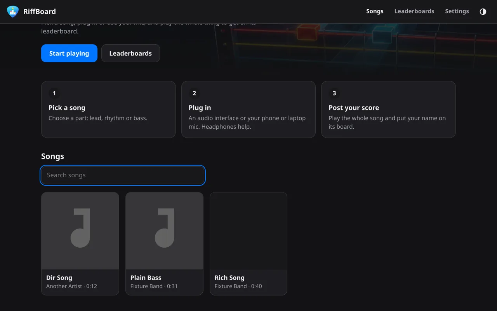
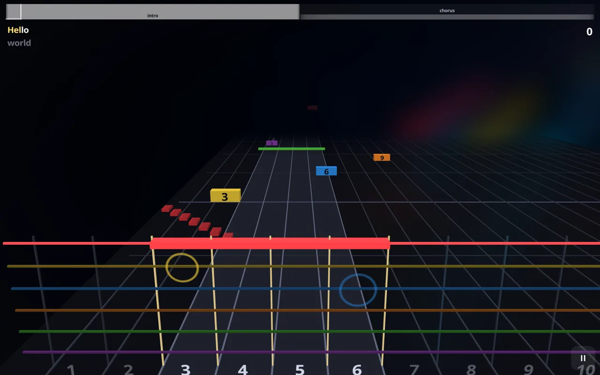

#  RiffBoard

**A play-along rhythm game for guitar and bass, with a leaderboard for every song.**

Pick a song, plug in your guitar or bass (or play near your microphone), and play along to a scrolling note highway in your browser. Host it for your band's songs or your own music, and anyone can come and play.


## Features

- **Smooth on anything**: a Rust game engine in the browser, smooth on phones and 120 Hz screens alike
- **Hears what you play**: the right note, at the right time. Audio never leaves your device
- **Score or practice**: play the whole song for the leaderboard, or jump to any section and practise
- **Leaderboards with no accounts**: type a name when you post a score
- **Your way round**: left-handed mode, string order, note speed, and mic and picture delay
- **Brand it as your band's site** with your own name, artwork and colours
- **Safe on the open internet**: visitors can only start a run and post a score, nothing else
- **Light and dark themes** that follow your system

| Songs | Leaderboard | Player |
|---|---|---|
|  |  |  |

## Install

You need Docker and your songs as [`.feedpak`](https://github.com/got-feedback/feedpak-spec) files.

```bash
git clone https://github.com/Imdabossou/RiffBoard.git
cd RiffBoard
mkdir library            # put your .feedpak files in here
docker compose up -d --build
```

Then open `http://<host>:8000`. The [hosting guide](docs/guide.md) covers HTTPS, settings, branding, moderation and how RiffBoard stays safe in public.

## Licence

Free and open source under the [GNU AGPL v3](LICENSE), the same licence as [fee[dB]ack](https://github.com/got-feedback/feedBack), which RiffBoard grew out of. Credit for the song format, the library and chart handling the server is based on, and the original player goes to the [fee[dB]ack contributors](https://github.com/got-feedback/feedBack/graphs/contributors). The Rubik font is under the SIL Open Font License.

Want to work on it? See [BUILDING.md](BUILDING.md).
